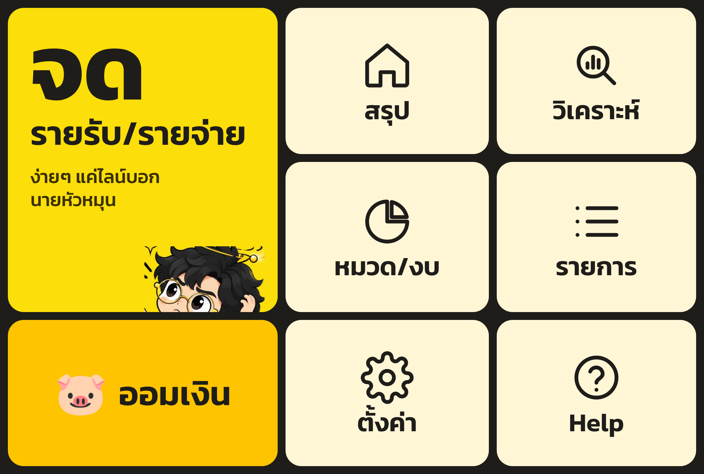

<p align="center"></p>

# หมุนตังค์ (Muntang)

ผู้ช่วยจดรายรับรายจ่ายผ่าน **LINE** ไม่ต้องโหลดแอปเพิ่ม พิมพ์ "ข้าว 50" หรือส่งรูปสลิปมาในแชท แล้วบอทจะจัดหมวด สรุปยอด และเตือนงบให้เอง ดูกราฟ แก้ไขรายการ และตั้งงบได้ผ่านแดชบอร์ด LIFF ที่เปิดในแอป LINE

ธีม **Premium Tech Creator**: Deep Space Black `#0D0D0D` · Carbon `#1A1A1A` · Cosmic Gold `#FFC400` · Neon Amber `#FFB300` · Moon White `#F5F5F5` พร้อมมาสคอต "นายหัวหมุน"



## ฟีเจอร์

| ฟีเจอร์ | ตัวอย่างในแชท |
|---|---|
| จดรายจ่าย (หลายรายการในข้อความเดียว หรือหลายบรรทัด) | `ข้าวมันไก่ 50` · `กาแฟ 45 ขนม 30` · `50 ค่ารถ` |
| จดรายรับ | `+เงินเดือน 25000` · `รับ ขายของ 1.2k` · `ถูกหวย 2000` |
| จดย้อนหลัง / ระบุวันที่ | `เมื่อวาน แท็กซี่ 120` · `12/10 ค่าไฟ 850` · `1/10/69 ค่าห้อง 4500` |
| ระบุช่องทางจ่าย | `ชาบู 459 บัตร` · `โอนค่าห้อง 4500` (เงินสด / โอน / บัตรเครดิต) |
| **AI อ่านสลิป/ใบเสร็จ** | ส่งรูปสลิปโอนเงิน → อ่านยอด วันที่ ผู้รับ ธนาคาร เลขอ้างอิง, กันสลิปซ้ำ |
| **AI เข้าใจประโยคยาว** | `วันนี้กินข้าวกับแฟน 350 แล้วเติมน้ำมันอีก 500` |
| จัดหมวดอัตโนมัติ 16 หมวด + เรียนรู้ | แตะปุ่มเปลี่ยนหมวดใต้ข้อความ → ครั้งหน้าจำคำนั้นให้ |
| **จดด้วยเสียง** 🎤 | กดไมค์ในแชทแล้วพูด "ข้าวมันไก่ห้าสิบบาท" (Cloudflare Workers AI · Whisper) |
| **นำเข้า PDF Statement** 📄 | ส่งไฟล์ PDF จากธนาคาร/บัตรเครดิต → นำเข้าทั้งเดือน ยกเลิกทั้งชุดได้ปุ่มเดียว (ใช้ Claude) |
| **แนบสลิป/ใบเสร็จเป็นหลักฐาน** 📎 | ส่งรูปตามหลังรายการภายใน 15 นาที หรือสลิปที่ AI อ่าน จะเก็บรูปไว้ดูในแดชบอร์ด (Cloudflare R2) |
| **จดในกลุ่ม LINE** 👥 | เชิญบอทเข้ากลุ่ม = สมุดบัญชีร่วมของครอบครัว/เพื่อน จำว่าใครจด ไม่จดข้อความคุยเล่น (`จด ...` เพื่อบังคับจด) |
| **รอบบัญชีตามวันเงินเดือนออก** 📅 | `รอบบัญชี 25` สรุปเดือน งบ และกราฟนับตามรอบ 25 - 24 |
| **ตั้งค่าครั้งแรก** ⚙️ | เพิ่มเพื่อนแล้วตอบ 3 คำถาม (วันเริ่มรอบ / งบ / เวลาเตือน) หรือพิมพ์ `ตั้งค่า` |
| **รายงานประจำเดือนอัตโนมัติ** 📬 | ส่งสรุปรอบที่แล้วให้ทุกวันแรกของรอบ 09:00 น. (`ปิดรายงาน` / `เปิดรายงาน`) |
| ยกเลิก / ลบ | `ลบ` (ลบล่าสุด) · `รายการ` (แตะ ✕ ลบรายการไหนก็ได้) |
| สรุป | `สรุป` · `สรุปสัปดาห์` · `สรุปเดือนนี้` · `สรุปเดือนที่แล้ว` |
| **กระเป๋าเงิน: หลายบัญชี / e-Wallet / บัตรเครดิต** 👛 | `บัญชี` · `เพิ่มบัญชี กสิกร 12000` · `เพิ่มบัตร KTC วงเงิน 20000` · `เพิ่มวอลเล็ท TrueMoney 500` · `ข้าว 50 กสิกร` · `ยอด กสิกร 12000` · `โอน 500 กสิกร ไป ทรู` · `จ่ายบัตร ktc 3000` · `กดเงิน 2000 กสิกร` (โอน/จ่ายบัตรไม่นับเป็นรายจ่ายซ้ำ) |
| **หนี้สิน / ค้างรับ / ความมั่งคั่งสุทธิ** 🧾 | `เพิ่มหนี้ ผ่อนรถ 150000 ผ่อน 6500 ดอก 3.5` · `จ่ายหนี้ ผ่อนรถ` · `ยืม แม่ 5000` · `ให้ยืม ต้น 500` · `รับคืน ต้น 500` |
| **สุขภาพการเงิน (คะแนน 0-100)** 💚 | `สุขภาพการเงิน` · แดชบอร์ดหน้า "เชิงลึก": อัตราการออม, ความเร็วการใช้เงิน, วงเงินบัตร, นับถอยหลังปลดหนี้, รายรับ-รายจ่าย 12 เดือน |
| ปฏิทิน & สลิป | แดชบอร์ดหน้า "รายการ" → ปฏิทินรายวัน / แกลเลอรีสลิป-ใบเสร็จ |
| งบประมาณ + แจ้งเตือน 80% / 100% | `งบ 15000` · `งบ อาหาร 5000` · `งบ` · `ลบงบ` |
| เป้าหมายการออม | `เป้า เที่ยวญี่ปุ่น 50000` · `ออม เที่ยวญี่ปุ่น 1000` · `ถอน ...` · `เป้า` |
| รายการประจำ (บันทึกเองทุกเดือน) | `ประจำ ค่าเน็ต 599 ทุกวันที่ 5` · `ประจำ` · `ลบประจำ 1` |
| เตือนจดทุกวัน | `เตือน 21:00` · `ปิดเตือน` |
| หารบิล | `หาร 900 3` |
| Streak จดต่อเนื่อง / No-Spend Day | `วันนี้ไม่ได้ใช้เงิน` |
| ส่งออก Excel/CSV | `ส่งออก` |
| แดชบอร์ด LIFF | ภาพรวมรายเดือน, กราฟรายวัน, อันดับหมวด, ค้นหา/กรอง, เพิ่ม-แก้-ลบรายการ, งบรายหมวด, เป้าหมาย, รายการประจำ, ตั้งค่า |
| Rich Menu | สรุปวันนี้ · แดชบอร์ด · สรุปเดือนนี้ · งบประมาณ · รายการล่าสุด · วิธีใช้ |

## ลองเล่นทันที (ไม่ต้องมีบัญชี LINE)

```bash
npm install
npm start
```

เปิด <http://localhost:3000/simulator/> เพื่อแชทกับบอทในหน้าจำลอง LINE และ <http://localhost:3000/app/> เพื่อดูแดชบอร์ดพร้อมข้อมูลตัวอย่าง (โหมดเดโมจะเปิดเองเมื่อยังไม่ได้ใส่ `LINE_CHANNEL_SECRET`)

หรือสร้างไฟล์เดโมไฟล์เดียวที่เปิดได้เลยโดยไม่ต้องมีเซิร์ฟเวอร์:

```bash
npm run build:demo   # -> dist/muntang-demo.html
```

## เชื่อมกับ LINE จริง

### 1. LINE Official Account
1. สร้างบัญชีที่ <https://manager.line.biz> → ตั้งค่า → Messaging API → เปิดใช้ (สร้าง Provider ชื่อ "หมุนตังค์")
2. ตั้งค่าการตอบกลับ: ปิดแชท / ข้อความทักทาย / ตอบกลับอัตโนมัติ (Webhook จะเปิดได้หลังใส่ URL)
3. ที่ <https://developers.line.biz/console> เก็บ *Channel secret* (Basic settings) และ *Channel access token* (Messaging API → Issue)

### 2A. Deploy บน Cloudflare Workers + D1 (แนะนำ, มีแผนฟรี)
1. Cloudflare Dashboard → **Storage & Databases → D1** → Create database ชื่อ `muntang` → คัดลอก *Database ID* ไปใส่ `database_id` ใน `wrangler.toml` แล้ว commit (ตารางสร้างให้อัตโนมัติ)
2. **Workers & Pages → Create → Import a repository** → เลือก repo และ branch นี้ → Deploy (คำสั่ง deploy ค่าเริ่มต้น `npx wrangler deploy`)
3. Worker → **Settings → Variables and Secrets** → เพิ่มแบบ *Secret*: `LINE_CHANNEL_SECRET`, `LINE_CHANNEL_ACCESS_TOKEN`, `APP_SECRET` (และ `ANTHROPIC_API_KEY`, `LIFF_ID`, `LINE_LOGIN_CHANNEL_ID` เมื่อพร้อม)
4. เปิด `https://muntang.<subdomain>.workers.dev/healthz` ต้องเห็น `"line":true`
- `BASE_URL` ไม่ต้องใส่ ระบบใช้โดเมนของ request ให้เอง
- เตือนรายวัน/รายการประจำทำงานผ่าน Cron Trigger (ตั้งไว้ใน `wrangler.toml` แล้ว)
- แผนฟรีจำกัด CPU ต่อ request ถ้าเจอ error "exceeded CPU" ใน Logs ให้อัปเกรด Workers Paid
- ทดสอบในเครื่อง: `npm run cf:dev` (ใช้ D1 จำลอง ใส่ค่าลับใน `.dev.vars`)

### 2B. หรือ Deploy เป็น Node.js (Railway / VPS / Docker)
- `npm start` หรือใช้ `Dockerfile` ตั้ง environment ตาม `.env.example`
- ข้อมูลเก็บเป็นไฟล์ JSON ใน `DATA_DIR` ต้องเป็นดิสก์ถาวร (เช่น Railway Volume ที่ `/data`)

### 3. Webhook
Developers Console → Messaging API → Webhook URL = `https://<โดเมน>/webhook` → Verify → เปิด *Use webhook*

### 4. LIFF แดชบอร์ด
สร้าง *LINE Login channel* ใน **Provider เดียวกัน** (คนละ Provider จะได้ userId คนละชุด) → แท็บ LIFF → Add
- Endpoint URL: `https://<โดเมน>/app/` · Size: Full · Scope: `openid`, `profile`
- ใส่ `LIFF_ID` และ `LINE_LOGIN_CHANNEL_ID` แล้วเปลี่ยน channel เป็น **Published**

### 5. Rich Menu
เปิด `https://<โดเมน>/admin/setup-richmenu?key=<APP_SECRET>` ในเบราว์เซอร์ (กดซ้ำได้ เมนูเก่าจะถูกแทนที่) หรือ `npm run richmenu:setup`

### 6. AI อ่านสลิป
- **ฟรี (ค่าเริ่มต้นบน Cloudflare):** ใช้ Cloudflare Workers AI (`@cf/meta/llama-4-scout-17b-16e-instruct`) ผ่าน binding `AI` ไม่ต้องมี API key ใช้โควตาฟรีรายวันของบัญชี อ่านรูปสลิป/ใบเสร็จและประโยคยาวได้ แต่ **อ่าน PDF ไม่ได้** · เปลี่ยนโมเดลด้วย `WORKERS_AI_MODEL` หรือปิดด้วย `FREE_AI=off`
- **Claude (แม่นกว่า + อ่าน PDF Statement ได้):** ใส่ `ANTHROPIC_API_KEY` ระบบจะใช้ Claude แทนอัตโนมัติ
- เช็กว่าใช้ตัวไหนอยู่ที่ `/healthz` (`"ai":"workers-ai"` หรือ `"ai":"claude"`)

## โครงสร้างโปรเจกต์

```
src/
  app.js           เส้นทาง HTTP ทั้งหมด (webhook, API แดชบอร์ด, หน้าจำลอง) แบบ Request -> Response
  worker.js        จุดเริ่มบน Cloudflare Workers (+ Cron Trigger)
  server.js        จุดเริ่มบน Node.js (Express เสิร์ฟไฟล์ + ตัวจับเวลา)
  line.js          เรียก LINE Messaging API / ตรวจลายเซ็น / ตรวจ LIFF token
  ai.js            Claude อ่านสลิป + แปลข้อความ (structured output)
  jobs.js          เตือนรายวัน + รายการประจำ
  store-d1.js      ฐานข้อมูล Cloudflare D1
  store.js         ฐานข้อมูลไฟล์ JSON (Node)
  core/            สมองของบอท ใช้ร่วมกันทั้งเซิร์ฟเวอร์และเบราว์เซอร์
    parser.js      แปลงข้อความไทย -> รายการ
    categories.js  หมวด + คีย์เวิร์ด
    accounts.js    กระเป๋าเงิน: ธนาคาร/e-Wallet/บัตรเครดิต/หนี้/ค้างรับ, ยอดคงเหลือ, วงเงิน, ไอคอน
    insights.js    คะแนนสุขภาพการเงิน, อัตราการออม, pace, ปลดหนี้
    bot.js         รับ event -> ตอบกลับ
    flex.js        Flex Message ธีมดำทอง
    ops.js         เพิ่ม/แก้/ลบ, สรุป, งบ, เป้าหมาย, รายการประจำ, CSV
public/
  app/             แดชบอร์ด LIFF
  simulator/       แชท LINE จำลอง
  js/ css/ assets/
scripts/           rich menu, เดโมไฟล์เดียว
test/              unit tests (npm test)
```

## แผนต่อยอด

- รับข้อความเสียง (แปลงเสียงเป็นข้อความ แล้วจดให้)
- ใช้ในกลุ่ม LINE สำหรับครอบครัว/รูมเมต และหารบิลอัตโนมัติ
- ย้ายฐานข้อมูลไป PostgreSQL / Firestore เมื่อผู้ใช้เยอะขึ้น
- รายงานสรุปประจำสัปดาห์แบบส่งเอง และแพ็กเกจพรีเมียม

## ไอคอนธนาคาร

ไอคอนใน `public/assets/banks/<id>.png` เป็นป้ายสีประจำธนาคาร + ตัวย่อที่วาดขึ้นเอง (สร้างใหม่ด้วย `npm run icons`)
ถ้าอยากใช้โลโก้จริงของธนาคาร ให้วางไฟล์ PNG สี่เหลี่ยมจัตุรัสชื่อเดียวกันทับ (เช่น `kbank.png`, `truemoney.png`) แล้ว deploy ใหม่ — แสดงทั้งในแชทและแดชบอร์ด
